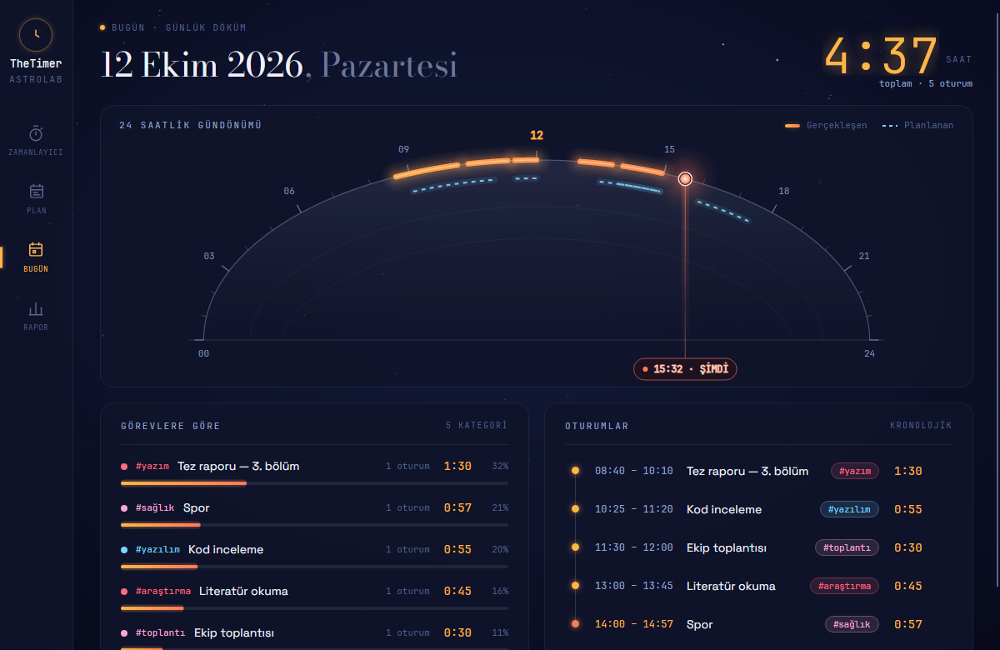

# TheTimer  
**Zaman tutma, geri sayım ve gün içi planlama uygulaması**

## Ekran Görüntüleri  
  
  
  


## Özellikler  
- Kronometre, geri sayım ve Pomodoro  
- Masaüstü bildirimleri (D‑Bus)  
- Tepsi ikonu (tray)  
- Çökme kurtarma  
- SQLite veri depolama (`~/.local/share/thetimer`)  
- Günlük planlama, yinelenen bloklar  
- Blok hatırlatıcıları  
- Plan vs. gerçekleşen karşılaştırması  
- Haftalık rapor  
- Astrolab koyu tasarım  

## Kurulum  

Hazır paketler [Releases](https://github.com/msozturktr/TheTimer/releases) sayfasında (`<ver>` = sürüm numarası, örn. `0.3.0`).

### Debian / Ubuntu  
```bash
sudo apt install ./thetimer_<ver>_amd64.deb
```

### Fedora  
```bash
sudo dnf install ./thetimer-<ver>-1.x86_64.rpm
```

### Flatpak (paket dosyası)  
```bash
flatpak install --user ./TheTimer-<ver>.flatpak
flatpak run io.github.msozturktr.TheTimer
```
*Not:* Çalışma ortamı (runtime) Flathub'dan indirilir; `flathub` remote'u ekli olmalı.  

### AppImage (hazır)  
```bash
chmod +x TheTimer-<ver>-x86_64.AppImage
./TheTimer-<ver>-x86_64.AppImage
```

### Arch Linux  
AUR'dan `thetimer-bin` ya da bu depodan:
```bash
cd packaging/aur && makepkg -si
```

### Tarball  
```bash
tar xzf thetimer-<ver>-linux-x64.tar.gz
./thetimer-<ver>-linux-x64/app/TheTimer
```
Kullanıcı bazlı kurulum adımları arşivdeki `INSTALL.txt` dosyasında.  

### Kaynaktan paket üretme  
#### Flatpak  
```bash
bash packaging/flatpak/build-flatpak.sh
flatpak run io.github.msozturktr.TheTimer
```

#### AppImage  
```bash
bash packaging/appimage/build-appimage.sh
```
Tüm sürüm paketleri: `packaging/build-release.sh <ver>` (çıktı `artifacts/release/`).

#### Kaynak kodundan  
```bash
dotnet run --project src/TheTimer.App
```
*Gereksinim:* .NET 10 SDK  

## Geliştirme  

```bash
dotnet build          # Derleme
dotnet test           # Testler
dotnet run --project tools/TheTimer.Screenshots -- <outDir>   # Ekran görüntüsü aracı
```

## Teknoloji  
- **Dil/Çatı:** C# / .NET 10  
- **UI:** Avalonia 12  
- **MVVM:** CommunityToolkit.Mvvm  
- **Veri:** SQLite (`Microsoft.Data.Sqlite`)  
- **Bildirim:** Tmds.DBus.Protocol (freedesktop D‑Bus)  

## Lisans  
MIT lisansı. Kullanılan yazı tipleri (Bodoni Moda, Space Grotesk, JetBrains Mono) SIL OFL 1.1 altında dağıtılmaktadır.